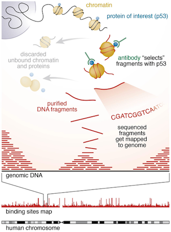
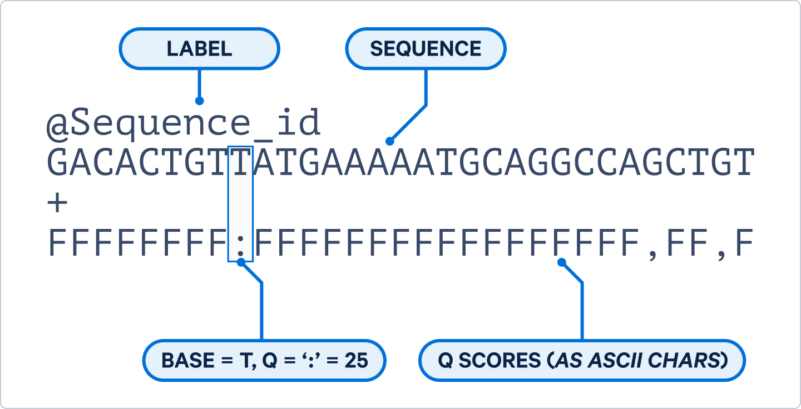

```{=html}
<script src="https://kit.fontawesome.com/ece750edd7.js" crossorigin="anonymous"></script>
```

## Getting Started

ChIP-seq (Chromatin immunoprecipitation followed by sequencing) is a lab based method to identify DNA-binding regions of specific proteins, often looking at either histone modifications or transcription factor binding sites, while the initial steps for these are the same, peak calling and downstream analysis will differ.

{width="299"}


## Connecting to the Server

Today, we will connect to one of the DRP servers to start our Linux journey. Connecting to the server is dependent on the machine you are working with. To connect

-   Both Linux and Mac have a "Terminal", which is command line and can connect to a server using ssh.
By typing in the following in your terminal, you can easily connect to the DRP server. \
*Replace \<UUN\> by your own UUN or username.*

``` bash
ssh <UUN>@bifx-core1.bio.ed.ac.uk
```

-   For Windows, a tool like [MobaXTerm](https://mobaxterm.mobatek.net/download.html) needs to be installed to be able to connect to a server easily.
Connecting uses ssh in this case as well. Take a look at the [MobaXTerm demo](https://mobaxterm.mobatek.net/demo.html) to learn how to connect using ssh. Make sure to use you UUN as your username and the server link as follow:
``` bash
bifx-core1.bio.ed.ac.uk
```

You might be asked if you trust the server, make sure to answer yes. Once you've entered your password you should connect to the server and see something like the following:

``` bash
Welcome to Ubuntu 24.04.4 LTS (GNU/Linux 6.8.0-117-generic x86_64)

 * Documentation:  https://help.ubuntu.com
 * Management:     https://landscape.canonical.com
 * Support:        https://ubuntu.com/pro
################################################################################
THIS DEVICE IS PART OF A PRIVATE NETWORK.

Unauthorised access or use of this equipment is prohibited 
and constitutes an offence under the Computer Misuse Act 1990.
If you are not authorised to use this system, terminate this 
session now.

All activity on this system is monitored and recorded.

Please direct any queries to IS.Helpline@ed.ac.uk.

################################################################################
<UUN>@bifx-core1:~$
```
This prompt shows that you are logged in to the bifx-core1 bioinformatics server, and that you are in your home directory (which is referred to using the ~ character on Linux systems).

Please see our [website](https://drp-hcb-bioinformatics.github.io/DRP-HCB-Bioinformatics/user_policy.html) for more specific instructions on using the DRP-HCB bioinformatics servers.


## Set Up Web Directory

The majority of you will have already done this, but if not we will create a public_html directory in your home, this will allow us to view the files we create later on (after we link our project folder to it).

``` bash
cd
mkdir ~/public_html
``` 
'cd' insures we are in our home space although '~/' specifies this is the path to your home anyway.

This should now be visible at;
https://bifx-core3.bio.ed.ac.uk/~username

Remember, this is public so do not link to all of your data here.


## Set up workshop directory

Lets start by creating a new folder for this workshop in our home directory
``` bash
cd 
mkdir ChIP-seq_workshop
```

We can now link this directory to our public page;
double check this
``` bash
ln -s ~/ChIP-seq_workshop ~/public_html/. 
```

:::: challenge
<h2><i class="fas fa-pencil-alt"></i> Challenge:</h2>

Before we retrieve our data lets make sure we are all set up, how do you check that you have created both your public_html and workshop directories?

<details>

<summary>Solution</summary>

::: solution
<h2><i class="far fa-eye"></i> Solution:</h2>

You can check if this was successfully created with 'ls' command 

Use 'pwd' to check it is in the correct location

:::

</details>
::::


## FASTQ Data

The FASTQ data used in this workshop has already been retrieved from ENCODE, for the purpose of this workshop it has been sub sampled to mostly map to a single chromosome, the full data sets are available on ENCODE [here](https://www.encodeproject.org/experiments/ENCSR000DWE/).

For reference, it is ChIP-Seq on Transcription Factor (TF) *CTCF* using human K562 cell line (chronic myelogenous leukemia), CTCF (CCCTC-binding factor) is a highly conserved zinc finger protein involved in 3D genome organisation and promoter enhancer interactions. There are two IP replicates and a single shared control (background input) sample, this is single end data.


| Accession | FileName | Condition | Replicate |
|---------|:-----|------:|:------:|
| ENCFF001HTO | CTCF_Rep1.fastq.gz  | IP |   One   |
| ENCFF001HTP | CTCF_Rep2.fastq.gz  | IP |  Two   |
| ENCFF001HTT | Input_Control.fastq.gz |  Input |   One    |


We will create a symbolic link to the data in our own project folders, storing it in a fastq folder;

``` bash
cd ChIP-seq_workshop
mkdir fastq
ln -s path_to_data/*fastq.gz fastq/.  *NEED TO ADD THIS*
```

MD5SUM?

##  FASTQ Format 

As a brief reminder, FASTQ files contain both sequence data and PHRED quality scores, this determines the likely hood that a given base call is correct.

{width="399"}

:::: challenge
<h2><i class="fas fa-pencil-alt"></i> Challenge:</h2>

How long are the reads?

<details>

<summary>Solution</summary>

::: solution
<h2><i class="far fa-eye"></i> Solution:</h2>

36bp
You can view the compressed FASTQ file with zless

zless fastq/CTCF_Rep1.fastq.gz | head

Or look at the file details from the above ENCODE link 

:::

</details>
::::


