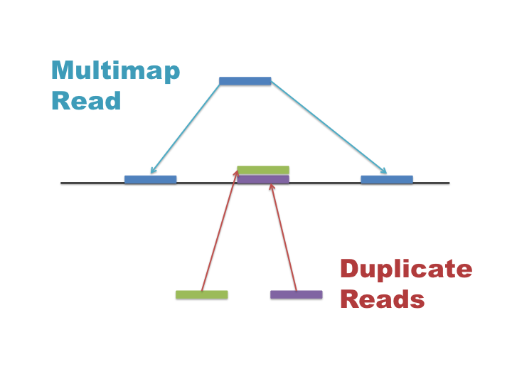

## Quality Control

The first step is to assess the quality of our sequencing data, we will be using [FastQC](https://www.bioinformatics.babraham.ac.uk/projects/fastqc/) and [MultiQC](https://seqera.io/multiqc/) to do this.


## FastQC

FastQC is a tool that provides simple quality control checks on FASTQ files and creates several exploratory plots. The command can take multiple files at once or you can use wildcards (*) to specify multiple files. Once running, it will provide a progress report for each file.

``` bash
cd fastq
fastqc *.fastq.gz
```

FastQC generates a zip file as well as an html file for each input. The html file is the easiest file to view and contains several plots and tables that provide information about the quality of the data. The zip file contains the raw data used to generate the plots, which can be useful for further analysis or troubleshooting.


Once this is finished you can view the reports via; https://bifx-core3.bio.ed.ac.uk/~username


In your web browser, navigate to your workshop folder and the reports are under fastq ending with '_fastqc.html'

Pre compiled FastQC reports are also available [here](https://bifx-core3.bio.ed.ac.uk/training/ASD/03_HTSDAC/reports/FastQC)

A reminder of what each section means can be found in the [FastQC docs](https://www.bioinformatics.babraham.ac.uk/projects/fastqc/Help/3%20Analysis%20Modules/)

Feel free to look through these but it's generally easier to aggregate our reports into one, we can do with with MultiQC.


## MultiQC

MultiQC provides a simple way to combine the results from multiple FastQC analyses into a single report, allowing you to assess the overall quality of a study and easily identify samples that may require further investigation.

MultiQC is straightforward to use and can summarise results from dozens or even hundreds of samples in a single, easy-to-navigate report. It can also aggregate reports from multiple different tools, for example Fastq Screen for contamination, see [previous workshop](https://drp-hcb-bioinformatics.github.io/High_throughput_sequencing_data/03_QC.html) for more details on this.

Run Multiqc while still in the fastq directory to combine the FastQC reports from all samples.

``` bash
multiqc .
```

You might need to refresh your browser to see this in the same space as your individual FastQC reports.

Look through the report(s) and discuss what needs to be done.

A Pre-processed MultiQC report is available [here](https://bifx-core3.bio.ed.ac.uk/training/ASD/03_HTSDAC/reports/multiqc_report.html).

:::: challenge
<h2><i class="fas fa-pencil-alt"></i> Challenge:</h2>

What is the quality of the reads like?

What looks odd and how might we explain it?

Are both replicates similar?

<details>

<summary>Solution</summary>

::: solution
<h2><i class="far fa-eye"></i> Solution:</h2>

The quality (~30) is good but trails off towards end

There is clearly some adapter contamination throughout

Rep2 looks slightly worse

Remember this is not a full data set so the lines are a bit more 'jaggy' than they would be.

:::

</details>
::::


## Trimming 

There are multiple trimming tools available, today we will use [Trim Galore](https://www.bioinformatics.babraham.ac.uk/projects/trim_galore/), this is actually a wrapper for [Cutadapt](https://cutadapt.readthedocs.io/en/stable/), see also [Trimmomatic](https://github.com/usadellab/trimmomatic). If you plan to do a lot of short read analysis it is definitely worth familiarising yourself with Cutadapt.

There are several different means of trimming data, by quality, length or by specific adapter sequence (or all of the above), this is carried out in a specific
order. First reads are trimmed based on our chosen quality filter, then for adapter contamination and finally any reads below our minimum length are discarded.

Trim Galore selects the correct adapter sequence for us, we are selecting a minimum phred quality of 20 and length of 20bp and a stringency of 3 which means atleast 3 bases must match our adapter sequence before trimming. The cores argument determines how many CPUs are used, it is able to handle all samples in one command.

``` bash
trim_galore --cores 4 --fastqc -q 20 --length 20 \
  --stringency 3 \
  CTCF_Rep1.fastq.gz \
  CTCF_Rep2.fastq.gz \
  Input_Control.fastq.gz
```

This generates new 'trimmed' FASTQ files as well as text reports (ending '_trimming_report.txt') but also runs FastQC for us on the trimmed data.

Reports can be viewed as text files;

``` bash
less fastq/CTCF_Rep1.fastq.gz_trimming_report.txt 
```

## QC on Trimmed Data

Once we have performed the trimming it's a good idea to re-run our FastQC and MultiQC to make sure the trimmed data is as expected and resolves any issues.

We can re-run MultiQC while adding the -f (force) argument to override our previous report and --fullnames to not clean our sample names and include the trimmed data.

``` bash
multiqc --fullnames -f .
```

Link to updated [MultiQC report](https://bifx-core3.bio.ed.ac.uk/training/ASD/03_HTSDAC/reports/trimmed_multiqc_report.html)

Individual pre-compiled FastQC reports are also available [here](https://bifx-core3.bio.ed.ac.uk/training/ASD/03_HTSDAC/reports/FastQC_trim)


Hopefully the cleaned data is now passing each section or atleast receiving a warning rather than a fail. Note I have subsampled a GC rich chromosome. Remember these tests are not absolute and depend on the specific data.


## Aligning reads

Now that we have our trimmed data, we can align our reads to our reference genome, we will use GRCh38/hg38, references are built from FASTA sequence files.

We already have the relevant reference FASTA file available on the server, this also includes indexes needed for the main alignment tools, these are required for the running of most tools.

If running on your own machine this can be obtained via;
``` bash
wget http://hgdownload.cse.ucsc.edu/goldenPath/hg38/bigZips/hg38.fa.gz
gunzip hg38.fa.gz
```

Today we will use [bowtie2](https://bowtie-bio.sourceforge.net/bowtie2/index.shtml) but there are several popular short read alignment tools available ([BWA](https://github.com/lh3/BWA/), [miniMap2](https://github.com/lh3/minimap2) *etc.*), these are generally interchangeable but for RNA-seq experiments it is strongly recommended to use [STAR](https://github.com/alexdobin/STAR) as it is splice aware.


We will point to the relevant index file but for reference this was created with;

``` bash
### do not run
#bowtie2-build -f /home/genomes/human/hg38/hg38.fa hg38
###
```

Lets create a bowtie2 output directory just for our alignments;

``` bash
cd ..
mkdir bt2_out
```

Assuming this index exists we can run the alignment with these commands, we are running each sample one by one, this will take a little while.

 - -p Processors (threads)
 - -x Basename of the genome index 
 - -U Unpaired data
 - -S Output in SAM format
 
 With 2> we are redirecting output to a log file

``` bash
# Rep 1
bowtie2 -p 4 -x /home/genomes/human/hg38/bowtie2_indexes/hg38 -U fastq/CTCF_Rep1_trimmed.fq.gz -S bt2_out/CTCF_Rep1.sam 2> bt2_out/CTCF_Rep1_bowtie2.log

# Rep 2
bowtie2 -p 4 -x /home/genomes/human/hg38/bowtie2_indexes/hg38 -U fastq/CTCF_Rep2_trimmed.fq.gz -S bt2_out/CTCF_Rep2.sam 2> bt2_out/CTCF_Rep2_bowtie2.log

# Input Control
bowtie2 -p 4 -x /home/genomes/human/hg38/bowtie2_indexes/hg38 -U fastq/Input_Control_trimmed.fq.gz -S bt2_out/Input_Control.sam 2> bt2_out/Input_Control_bowtie2.log

```

The output *alignments* are in the **Sequence Alignment/Map (SAM)** format, generally we can output/convert directly into the compressed 'binary' **BAM** format but lets take a closer look at the SAM files.


## SAM Format

Sequence Alignment/Map (SAM) files contain our alignment positions as well as columns contaning information on the quality of the alignment, mismatches, the number of times a read mapped, mapping of paired ends and other custom flags and statistics. 

See the [Docs](https://samtools.github.io/hts-specs/SAMv1.pdf) for the full specification.


[SAM diagram here] *NEED TO ADD THIS*


Let's take a look at one of our SAM files.

``` bash
samtools view  bt2_out/CTCF_Rep1.sam | less
```

Each alignment contains a **SAM flag** which encodes information, this can be used for downstream filtering or reporting.

## SAMTOOLS


[Samtools](https://www.htslib.org/) is a powerful tool for working with SAM/BAM files.


Here we are sorting our SAM alignments into the compressed BAM format, and also indexing the BAM files as downstream tools require this.

- -@ specifices threads/CPUs
- -o Output is specified as a parameter 

``` bash
# Rep 1
samtools sort -@ 4 -o bt2_out/CTCF_Rep1.bam bt2_out/CTCF_Rep1.sam
samtools index bt2_out/CTCF_Rep1.bam

# Rep 2
samtools sort -@ 4 -o bt2_out/CTCF_Rep2.bam bt2_out/CTCF_Rep2.sam
samtools index bt2_out/CTCF_Rep2.bam

# Input Control
samtools sort -@ 4 -o bt2_out/Input_Control.bam bt2_out/Input_Control.sam
samtools index bt2_out/Input_Control.bam

```


Samtools Flagstat summarises the mapping rate for reads

``` bash
samtools flagstat bt2_out/CTCF_Rep1.bam
```

We can see there are 779,426 reads, 770,259 of which mapped.


Let's confirm how many are unmapped, here we are filtering (-f) using the samflag for unmapped (04) and counting (-c) with samtools view

``` bash
samtools view -c -f 4 bt2_out/CTCF_Rep1.bam
```

We should see 9,167 are unmapped, this was actually in our Bowtie2 log


:::: challenge
<h2><i class="fas fa-pencil-alt"></i> Challenge:</h2>

How many reads mapped to replicate 2?

<details>

<summary>Solution</summary>

::: solution
<h2><i class="far fa-eye"></i> Solution:</h2>

You could use;
samtools flagstat bt2_out/CTCF_Rep2.bam

653498

Or being clever you could count excluding unmapped flag with '-F' rather an '-f'

samtools view -c -F 4 bt2_out/CTCF_Rep2.bam

Also you check the bowtie2 logs;
less bt2_out/CTCF_Rep2_bowtie2.log

:::

</details>
::::


We can look at where our reads align with idxstats;

``` bash
samtools idxstats bt2_out/CTCF_Rep1.bam | grep -E '^chr[0-9XYM]+\b'
```
There are a lot of additional chromosomes contigs here so we're just filtering out the main ones.

The fist column is the chromosome, the second is its size and the third is the number of mapped reads, can you tell which chromosome has the most mapped reads?


# Filtering Data

Multimap reads map to multiple locations with equal probability, they are encoded as SAM flag 256 'secondary alignment' or 'not primary alignment'

{width="399"}

A key point is that different alignment tools handle multimap reads differently by default, this can be controlled by tool options but in our case bowtie2 has randomly selected a multimapped alignment, flagged it with a low **MAPQ score** and discarded other possible locations. Mapping Quality (MAPQ) predicts the likelihood the alignment is accurate.

Looking back at our Bowtie2 Logs, we can see how many unique vs multimapped reads we have.

``` bash
less bt2_out/CTCF_Rep1_bowtie2.log
```

779426 reads; of these:

  779426 (100.00%) were unpaired; of these:
  
    9167 (1.18%) aligned 0 times
    
    546826 (70.16%) aligned exactly 1 time
    
    223433 (28.67%) aligned >1 times
    
98.82% overall alignment rate


A note on duplicates, distinct from multimap reads are duplicates which all map to the same location, thsee are often PCR artifacts but we cannot distinguish noise from genuine signal so it it generally not recommended to remove these, although it is possible to mark duplicates for downstream analysis, this can be done with [picard tools](https://broadinstitute.github.io/picard/command-line-overview.html#MarkDuplicates).

We've seen we can filter our reads using SAM Flags to count, this can also be useful for filtering out specific reads to exclude or that may be of interest to us.
We can also combined multiple flags e.g. Unmapped (04) plus not primary alignment (256) = 260. 

A useful resource for this is [explain flags](https://broadinstitute.github.io/picard/explain-flags.html)

A more efficient way to achieve this is by *MAPQ* score, here we are using -q 20 to filter based on MAPQ, this is filtering out low probability (1/100) alignments and unmapped reads. Note that different aligners calculate MAPQ in completely different and often complex ways, so using any one set filter is not universal.

Note we are saving the output as _filtered.bam, this is what we will us going forward so again we will index that file.

``` bash
# Rep 1
samtools view -@ 4 -b -q 20 bt2_out/CTCF_Rep1.bam > bt2_out/CTCF_Rep1_filtered.bam
samtools index bt2_out/CTCF_Rep1_filtered.bam

# Rep 2
samtools view -@ 4 -b -q 20 bt2_out/CTCF_Rep2.bam > bt2_out/CTCF_Rep2_filtered.bam
samtools index bt2_out/CTCF_Rep2_filtered.bam

# Input Control
samtools view -@ 4 -b -q 20 bt2_out/Input_Control.bam > bt2_out/Input_Control_filtered.bam
samtools index bt2_out/Input_Control_filtered.bam
```

Take a look at your filtered file;
``` bash
samtools flagstat bt2_out/CTCF_Rep1_filtered.bam
```

We now have 614,524 alignments after filtering


For some genomes there are blacklisted regions available as annotations, these are problematic areas which can cause issues with alignments, it is not strictly necessary today but we could use these to filter out alignments that cover the specific genomics region defined in that coorindate [BED](https://genome.ucsc.edu/FAQ/FAQformat.html#format1) file using [BedTools](https://bedtools.readthedocs.io/en/latest/) for example.


## Coverage Tracks

Technically we can view our BAM files in a genome browser (right down to the individual base calls), but despite being compressed these files are still large and not easily view-able, they simply contain all of our alignments so make no account for sequencing depth. We want to convert our BAMs into a binned format so we can view it as a **coverage track**.

[Bedgraph](https://genome.ucsc.edu/goldenPath/help/bedgraph.html) files are human readable and contain continuous coordinate data with value scores, [BigWig](https://genome.ucsc.edu/goldenPath/help/bigWig.html) contain the same information in compressed binary format and are excellent for genome browsers.

To create out bigWig tracks we are using [bamCoverage](https://deeptools.readthedocs.io/en/develop/content/tools/bamCoverage.html) which is a part of the [DeepTools](https://deeptools.readthedocs.io/en/latest/) package of tools.


Multiple methods of normalization as available, here we are using Bins Per Million (BPM) to handle read depth, we are selecting a bin or window size of 10.

``` bash
bamCoverage \
  -b bt2_out/CTCF_Rep1_filtered.bam \
  -o bt2_out/CTCF_Rep1.bw \
  --binSize 10 \
  --normalizeUsing BPM \
  --numberOfProcessors 4

bamCoverage -b bt2_out/CTCF_Rep2_filtered.bam -o bt2_out/CTCF_Rep2.bw --binSize 10 --normalizeUsing BPM --numberOfProcessors 4
bamCoverage -b bt2_out/Input_Control_filtered.bam -o bt2_out/Input_Control.bw --binSize 10 --normalizeUsing BPM --numberOfProcessors 4

```


In the next section we will visualise our bigWig files in [IGV](https://igv.org/doc/desktop/#DownloadPage/), it is also possible to upload your tracks to online genome browsers such as [UCSC](https://genome.ucsc.edu/), [ensembl](https://useast.ensembl.org/index.html) or the [IGV web app](https://igv.org/app/).


:::: key-points
<h2><i class="fas fa-thumbtack"></i> Key points</h2>

- How to assess FASTQ quality
- When and what to Trim
- Align to the correct reference
- Alignments are in SAM/BAM format
- Filtering based on SAM Flags and MAPQ Scores
- Coverage Track formats

::::

