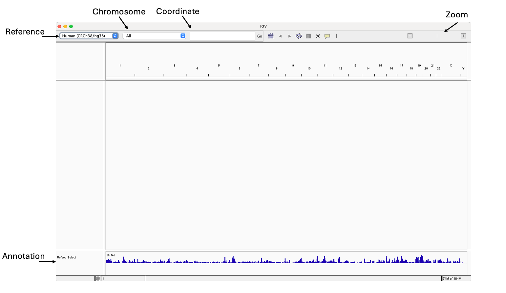

## Visualisation

## IGV

Open [IGV]() on your own machines, before adding any files the first step is to select the relevant genome in the top left, this should already be set to GRCh38/hg38 (changing this will clear the entire view), you can navigate using the chromosome tab or searching for a specific loci. You can also drag the curser along the top ruler to select a region or use the chromosome to navigate, you can zoom in and out using the top right scale. Along the bottom we can see gene annotations, we can add custom BED files here if needed.

{width="100%" height="auto"} 

## Loading Tracks

Using your web directory, navigate to the three bigWig files (ending '.bw'), you can either download your data or copy the link address and then within IGV select FILE/Load from File Or Load from URL, additionally you can simply drag and drop files/links into the main IGV window to view them.

{width="100%" height="auto"} 

Click and hold on a track to move left and right, or right click to see options available for each track, on the left panel you can see track information, it is possible to select multiple tracks here.

We expect our input to look relatively flat, with peaks throughout or ChIP data, hopefully consistent between replicates. Take some time to navigate the genome, play around with different options for the tracks and have a closer look at chromosome 19, do you see peaks that look real? Are they seen in both replicates with a flat background input, conversely to you see any obvious peaks in the input? Later we will run peak calling and view these in IGV but its always good to examine the data at the earliest opportunity.

[diagram zoomed in on bw tracks with different options selected]
{width="100%" height="auto"}

Try adding a BAM track (easiest to use URL for this), you'll need to zoom in close to see anything, notice IGV create a basic track for us, does this look the same as your bigWig? Have a very close look at the alignments, what do the different coloured bands mean?

[diagram with BAM]
{width="100%" height="auto"}

Keep this open for now,  we will come back to it later.
