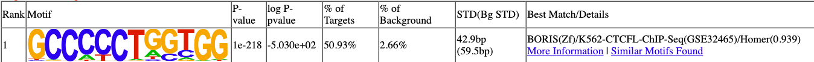
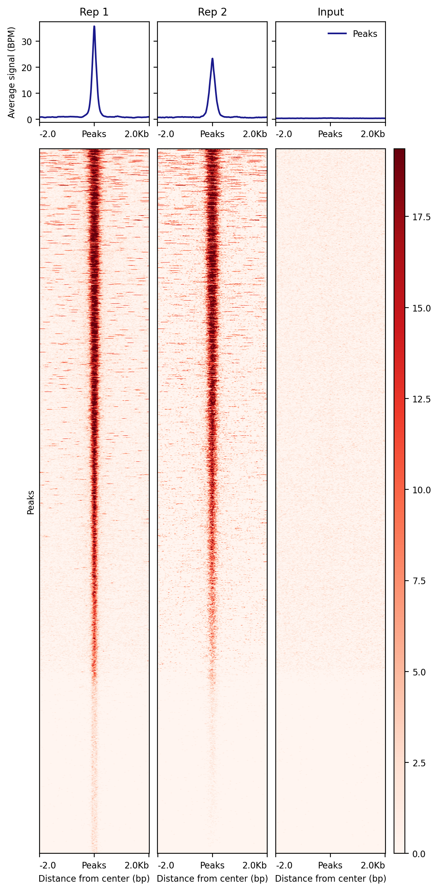

## Analysis

Previously we assessed the quality of the sequencing and alignments but how about the success of our actual experiment?


## MACS2

Model-based Analysis for ChIP-Seq [MACS2](https://github.com/macs3-project/MACS) is used to identify peaks, it operates on BAM files.

- -g (Genome Size) hs for Homo sapiens
- -t treatment IP file
- -c control input file
- -f BAM format
- --nomodel (used here as this is a small dataset)

``` bash
# check in correct workspace (ChIP-seq_workshop)
mkdir macs2_results
```

``` bash
# Replicate 1
macs2 callpeak -t bt2_out/CTCF_Rep1_filtered.bam \
  -c bt2_out/Input_Control_filtered.bam \
  -f BAM -g hs -n CTCF_Rep1 --nomodel \
  --outdir macs2_results/

# Replicate 2
macs2 callpeak -t bt2_out/CTCF_Rep2_filtered.bam \
  -c bt2_out/Input_Control_filtered.bam \
  -f BAM -g hs -n CTCF_Rep2 --nomodel \
  --outdir macs2_results/
```

Once we have called our peaks we can add these to our IGV session, but first lets start the next step running, we will examine the sequence at our peaks for specific motifs.


## HOMER

We will just run this on our first replicate, we are using a script from the HOMER suite of tools, we will select the top 500 peaks to speed things up.


``` bash
sort -k9,9nr macs2_results/CTCF_Rep1_peaks.narrowPeak | head -n 500 > macs2_results/CTCF_Rep1_top500_peaks.narrowPeak
```

It requires a FASTA file and parsed folder, we will just create a symbolic link to these;

``` bash
ln -s /home/genomes/human/hg38/hg38.fa .
ln -s PATHTO/preparsed .
```

This is alspo available here;
[NEED TO ADD THIS]


-size 200 limit
-mask repeats
``` bash
findMotifsGenome.pl macs2_results/CTCF_Rep1_top500_peaks.narrowPeak hg38.fa -preparsedDir preparsed/ homer_results/ -size 200 -mask -p 4
```

This generates a html report, 'homerResults.html', we should see CTCF as our best match.

{width="599"}

While that's running lets go back and look at out peak files in IGV.


## Visually Inspect Peak Files

Go back to your web browser and navigate to the macs2_results, here we want to download our '.narrowPeaks' files

The columns are as follows:

- Chromosome
- Start
- End
- Iterative id given by MACS2
- Integer score for display
- Strand (irrelevant in this case)
- Fold-change (fold enrichment for this peak summit against random Poisson distribution with local lambda)
- log10 P-value (e.g., 17.68 is 1 x 10-17)
- log10 Q-value from Benjamini–Hochberg–Yekutieli procedure
- Relative summit position to peak start


[diagram in IGV with peaks added]


## DeepTools

Deeptools contains some useful plotting tools to summarise our data, lets create a heatmap across our peaks, we can run this for all our samples, this requires a two step process.

- referencePoint centre of peak
- a upstream distance from reference
- b downstream distance from reference

``` bash
computeMatrix reference-point \
  -S bt2_out/CTCF_Rep1.bw bt2_out/CTCF_Rep2.bw bt2_out/Input_Control.bw \
  -R macs2_results/CTCF_Rep1_peaks.narrowPeak \
  --referencePoint center \
  -a 2000 -b 2000 \
  -o CTCF_multi_matrix.gz \
  -p 4
```

Once our matrix is created we can customise out plot

``` bash
plotHeatmap -m CTCF_multi_matrix.gz \
  -out CTCF_multi_heatmap.png \
  --colorMap Reds \
  --samplesLabel "Rep 1" "Rep 2" "Input" \
  --refPointLabel "Peaks" --regionsLabel "Peaks" \
  --yAxisLabel "Average signal (BPM)" --xAxisLabel "Distance from center (bp)" --yAxisLabel "Average signal (BPM)" 
```

{width="599"}

::: key-points
<h2><i class="fas fa-thumbtack"></i> Key points</h2>

- Peak calling
- Motif Discovery
- Deeptools plotting
:::


The commands in the workflow have been run one by one but basically forms the basis of a bash script, with a small amount of tweaking this could be modified to handle multiple samples simultaneously, this along with more sophisticated methods will be covered in a later workshop. While the steps for general bioinformatics pipelines are similar the tools and parameters used are specific to the data and experiment type.
  

## OPTIONAL EXCERCISE

current idea is histone data with pre-processed bam, get them to re-run peak calling --broad and look at data, maybe evaluate data somehow with deeptools

or get them to process some other data from scratch


