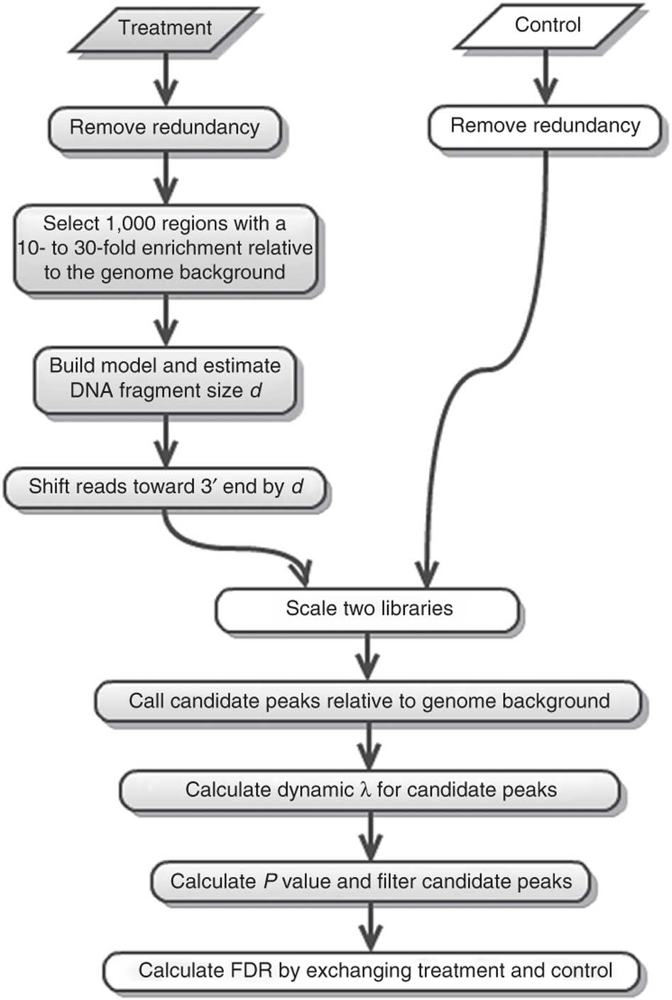
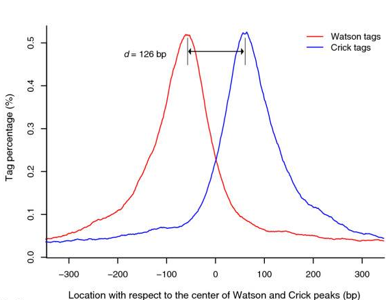
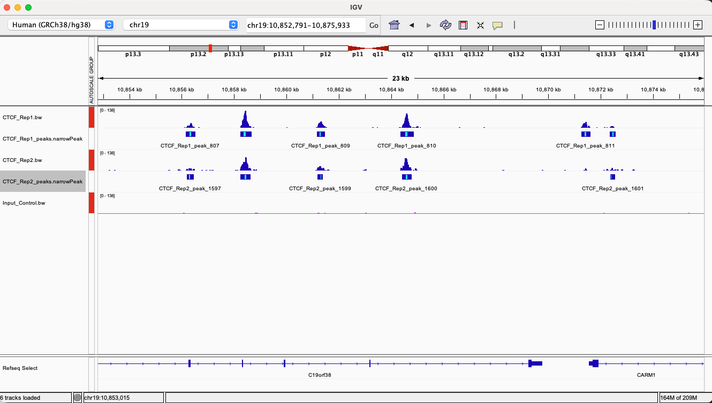

## Analysis

Previously we assessed the quality of the sequencing and alignments but how about the success of our actual experiment?


## MACS2

Model-based Analysis for ChIP-Seq [MACS2](https://github.com/macs3-project/MACS) is used to identify peaks, it operates on BAM files.

- -g (Genome Size) hs for Homo sapiens
- -t treatment IP file
- -c control input file
- -f BAM format
- --nomodel (used here as this is a small dataset)

``` bash
# check in correct workspace (ChIP-seq_workshop)
mkdir macs2_results
```

``` bash
# Replicate 1
macs2 callpeak -t bt2_out/CTCF_Rep1_filtered.bam \
  -c bt2_out/Input_Control_filtered.bam \
  -f BAM -g hs -n CTCF_Rep1 --nomodel \
  --outdir macs2_results/

# Replicate 2
macs2 callpeak -t bt2_out/CTCF_Rep2_filtered.bam \
  -c bt2_out/Input_Control_filtered.bam \
  -f BAM -g hs -n CTCF_Rep2 --nomodel \
  --outdir macs2_results/
```

Here is a concise description of the Macs2 method for Reference:

{width="599"}


- Removing redundancy - MACS retains uniquely mapped reads and removes reads that are repeatedly mapped to the same location. This reduces effects of PCR amplification biases during library preparation.

- Build model and estimate fragment size - one of the MACS inputs is the fragment size or bandwidth, which is approximate size of DNA fragments generated during fragmentation step of library preparation. MACS first slides a window sized at twice the bandwidth across the genome and finds instances where read counts enriched by between 10 and 30 fold relative to the genome background. It then randomly samples 1,000 of such regions and builds the model. To build the model it separates reads mapping to each of the strands and builds two distributions (two modes). The midpoint between the two modes is the middle of the binding size and the distance between the modes is the fragment size d (see Figure below).

- Generate peaks - now that d has been defined MACS slides a window of size 2d across the genome to identify regions significantly enriched in the ChIP sample. MACS assumes that background reads obey [Poisson distribution](https://en.wikipedia.org/wiki/Poisson_distribution). Thus given the number of reads in a given interval within the control sample we can calculate the probability of having observed number of reads in the ChIP sample (e.g., see flood example [here](https://en.wikipedia.org/wiki/Poisson_distribution#Examples_of_probability_for_Poisson_distributions)). This procedure is performed for several intervals around the examined location (2d, 1kb, 5kb, 10kb, and the whole genome) and the maximum value is chosen. One problem with this approach is that it only works if both samples (ChIP and control) are sequenced to the same depth, which is not usually happening in practice. To correct this MACS scales down the larger sample.

- Compute False Discovery Rate (FDR) - [Feng:2012](https://www.nature.com/articles/nprot.2012.101) explains computing FDR in MACS as follows: “When a control sample is available (and you should really always use it), MACS can also estimate an empirical FDR for every peak by exchanging the ChIP-seq and control samples and identifying peaks in the control sample using the same set of parameters used for the ChIP-seq sample. Because the control sample should not exhibit read enrichment, any such peaks found by MACS can be regarded as false positives. For a particular P value threshold, the empirical FDR is then calculated as the number of control peaks passing the threshold divided by the number of ChIP-seq peaks passing the same threshold.”

Peaks mapped to two strands are treated separately to build two coverage density profiles - two modes. The distance between the modes is the fragment size d.

{width="499"}


Once we have called our peaks we can add these to our IGV session, but first lets start the next step running, we will examine the sequence at our peaks for specific motifs.

These are in .narrowPeaks files, the columns are as follows:

- Chromosome
- Start
- End
- Iterative id given by MACS2
- Integer score for display
- Strand (irrelevant in this case)
- Fold-change (fold enrichment for this peak summit against random Poisson distribution with local [lambda](https://en.wikipedia.org/wiki/Poisson_distribution))
- log10 P-value (e.g., 17.68 is 1 x 10-17)
- log10 Q-value from [Benjamini–Hochberg–Yekutieli procedure](https://en.wikipedia.org/wiki/False_discovery_rate#Benjamini.E2.80.93Hochberg.E2.80.93Yekutieli_procedure)
- Relative summit position to peak start


## HOMER

[HOMER](http://homer.ucsd.edu/homer/index.html) was initially developed to automate the process of finding enriched motifs in ChIP-seq peaks, here we are using a perl [script](http://homer.ucsd.edu/homer/ngs/peakMotifs.html) included with Homer.
We will just run this on our first replicate, first we will select the top 500 peaks to speed things up.

Filtered sort by Q value column, then output only top 500 to file
``` bash
sort -k9,9nr macs2_results/CTCF_Rep1_peaks.narrowPeak | head -n 500 > macs2_results/CTCF_Rep1_top500_peaks.narrowPeak
```

Homer requires a FASTA file and 'preparsed' folder, we will just create a symbolic link to these;

``` bash
ln -s /home/genomes/human/hg38/hg38.fa .
ln -s /library/training/ASD/03_HTSDAC/preparsed .
```

-size 200 limit

-mask repeats
``` bash
findMotifsGenome.pl macs2_results/CTCF_Rep1_top500_peaks.narrowPeak hg38.fa homer_results/ -preparsedDir preparsed -size 200 -mask -p 4
```

Note, If running on own machine, it would be easiest to omit the '-preparsedDir preparsed/' and this will build from your hg38.fa file.

This generates a html report, 'homerResults.html', we should see CTCF as our best match.

{width="599"}

While that's running lets go back and look at out peak files in IGV.


## Visually Inspect Peak Files

Go back to your web browser and navigate to the macs2_results, here we want to download our '.narrowPeaks' files

{width="100%" height="auto"}

Go back to the peaks/Regions of interest you examined before, are the results what you expected? Can you see where the highest point of the peak is from the narrowPeak file? Are there any other output tracks from Macs2? Can you navigate to the above region adjacent to CARM1 gene?


## DeepTools

Deeptools contains some useful plotting tools to summarise our data, lets create a heatmap across our peaks to see how strong the signal is, we can run this for all our samples, this requires a two step process.

- referencePoint centre of peak
- a upstream distance from reference
- b downstream distance from reference

``` bash
computeMatrix reference-point \
  -S bt2_out/CTCF_Rep1.bw bt2_out/CTCF_Rep2.bw bt2_out/Input_Control.bw \
  -R macs2_results/CTCF_Rep1_peaks.narrowPeak \
  --referencePoint center \
  -a 2000 -b 2000 \
  -o CTCF_multi_matrix.gz \
  -p 4
```

Once the above matrix file is created we can plot and customise our heatmap, feel free to play around with any  [parameters](https://deeptools.readthedocs.io/en/develop/content/tools/plotHeatmap.html).

``` bash
plotHeatmap -m CTCF_multi_matrix.gz \
  -out CTCF_multi_heatmap.png \
  --colorMap Reds \
  --samplesLabel "Rep 1" "Rep 2" "Input" \
  --refPointLabel "Peaks" --regionsLabel "Peaks" \
  --yAxisLabel "Average signal (BPM)" --xAxisLabel "Distance from center (bp)" --yAxisLabel "Average signal (BPM)" 
```

{width="599"}


:::: challenge
<h2><i class="fas fa-pencil-alt"></i> Challenge:</h2>

Can you re plot this but change the colormap?

<details>

<summary>Solution</summary>

::: solution
<h2><i class="far fa-eye"></i> Solution:</h2>

See help;

--colorMap

Color map to use for the heatmap. If more than one heatmap is being plotted the color of each heatmap can be enter individually (e.g. –colorMap Reds Blues). Color maps are recycled if the number of color maps is smaller than the number of heatmaps being plotted. Available values can be seen [here](http://matplotlib.org/users/colormaps.html): The available options are: ‘magma’, ‘inferno’, ‘plasma’, ‘viridis’, ‘cividis’, ‘twilight’, ‘twilight_shifted’, ‘turbo’, ‘Blues’, ‘BrBG’, ‘BuGn’, ‘BuPu’, ‘CMRmap’, ‘GnBu’, ‘Greens’, ‘Greys’, ‘OrRd’, ‘Oranges’, ‘PRGn’, ‘PiYG’, ‘PuBu’, ‘PuBuGn’, ‘PuOr’, ‘PuRd’, ‘Purples’, ‘RdBu’, ‘RdGy’, ‘RdPu’, ‘RdYlBu’, ‘RdYlGn’, ‘Reds’, ‘Spectral’, ‘Wistia’, ‘YlGn’, ‘YlGnBu’, ‘YlOrBr’, ‘YlOrRd’, ‘afmhot’, ‘autumn’, ‘binary’, ‘bone’, ‘brg’, ‘bwr’, ‘cool’, ‘coolwarm’, ‘copper’, ‘cubehelix’, ‘flag’, ‘gist_earth’, ‘gist_gray’, ‘gist_heat’, ‘gist_ncar’, ‘gist_rainbow’, ‘gist_stern’, ‘gist_yarg’, ‘gnuplot’, ‘gnuplot2’, ‘gray’, ‘hot’, ‘hsv’, ‘jet’, ‘nipy_spectral’, ‘ocean’, ‘pink’, ‘prism’, ‘rainbow’, ‘seismic’, ‘spring’, ‘summer’, ‘terrain’, ‘winter’, ‘Accent’, ‘Dark2’, ‘Paired’, ‘Pastel1’, ‘Pastel2’, ‘Set1’, ‘Set2’, ‘Set3’, ‘tab10’, ‘tab20’, ‘tab20b’, ‘tab20c’, ‘grey’, ‘gist_grey’, ‘gist_yerg’, ‘Grays’, ‘rocket’, ‘mako’, ‘vlag’, ‘icefire’

:::

</details>
::::


Deeptools offers a lot of plotting functions to assess short read data, take a look at the [List of Tools](https://deeptools.readthedocs.io/en/develop/content/list_of_tools.html), particularly those for QC and summaries, you should have the relevant files already.


::: key-points
<h2><i class="fas fa-thumbtack"></i> Key points</h2>

- Peak calling
- Motif Discovery
- Deeptools plotting
:::


The commands in the workflow have been run one by one but basically forms the basis of a bash script, with a small amount of tweaking this could be modified to handle multiple samples simultaneously, this along with more sophisticated methods will be covered in a later workshop. While the steps for general bioinformatics pipelines are similar the tools and parameters used are specific to the data and experiment type.
  

## Optional Exercise

Retrieve some short read FASTQ data (possibly from the previous workshop), perform trimming if needed and map to the relevant reference genome, consider if the aligner used is correct for that data and what implications this has for downstream processing. If performing peak calling consider whether broad peak calling more appropriate. If interested in RNA-Seq analyis see this [previous workshop](https://swebb1.github.io/WACCBIP_RNA-seq_Workshop/lesson1_command_line.html), please note it won't be possible to follow this exactly as it was designed for a specific system but the steps taken will be the same.


